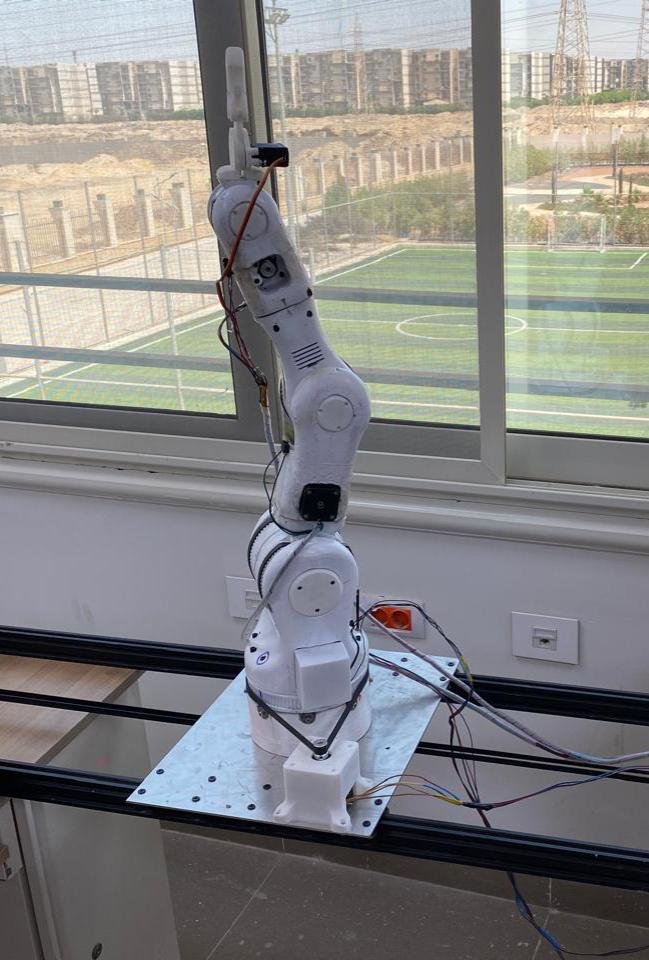
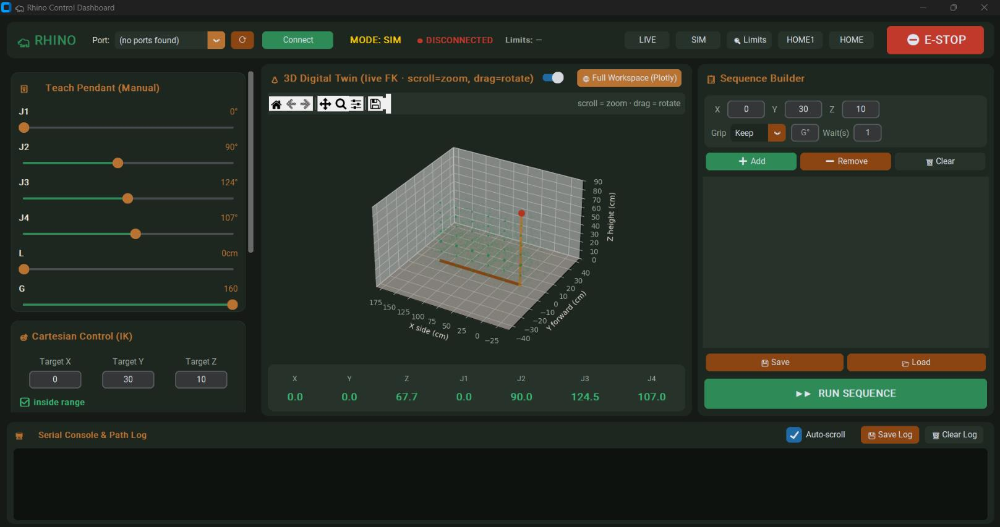
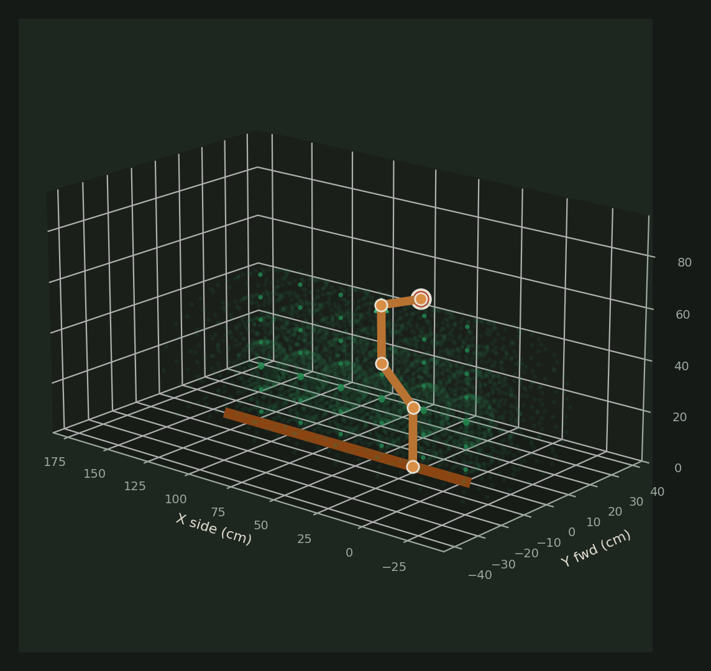
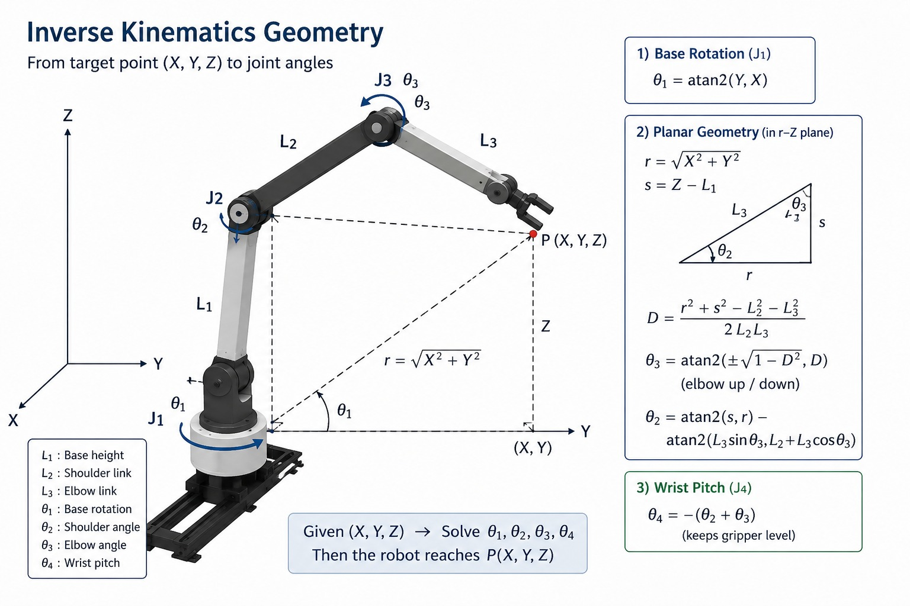
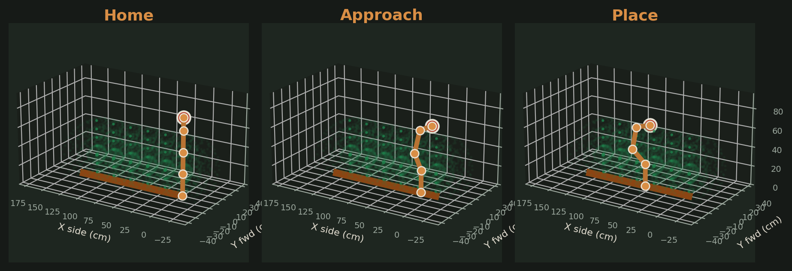
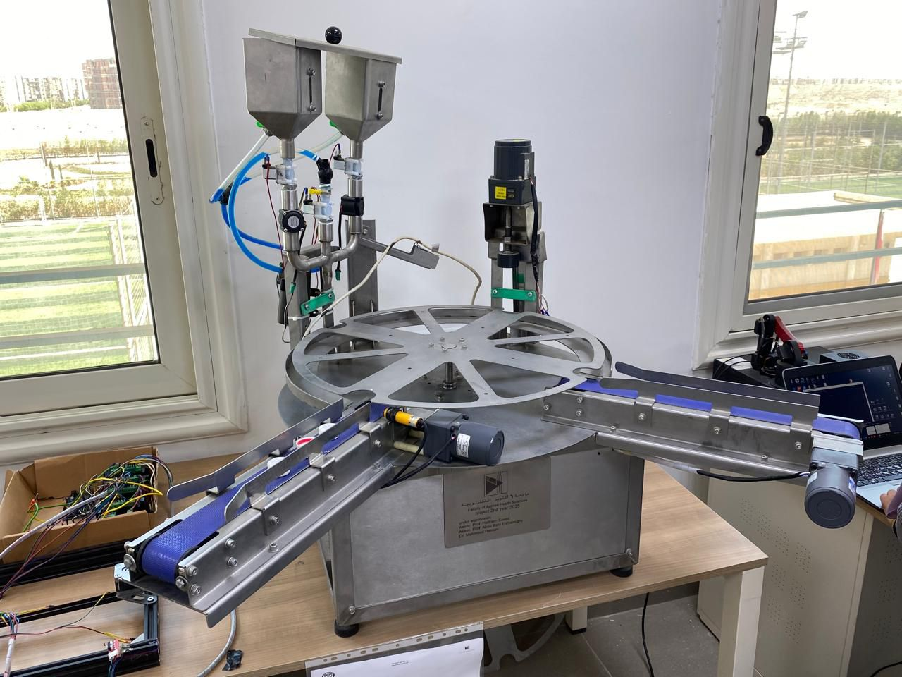

# Rhino — Industrial 5-DOF Robotic Arm for Pharmaceutical Filling-Line Automation

Graduation project, **6th of October Technological University — Information Technology Program
(Software Track), academic year 2025–2026**, developed by a **team of 5 students**.

Rhino is a low-cost, industrial 5-DOF robotic arm mounted on a linear track, built to automate
bottle handling on pharmaceutical filling lines. It picks empty bottles, places them on the
filling-machine infeed, and after filling and capping unloads the finished bottles into the
packaging area — removing direct human contact from the process to preserve sterility and
guarantee repeatable operation.

> **About this repository:** the original team's source files were not available, so the
> firmware and dashboard in this repo were **reconstructed from the project's own graduation
> documentation** (the 79‑page project book and the defense presentation) by the team member
> who built the software side. They follow the documented architecture, dimensions, command
> protocol, and algorithms — they are **not the original team's source files**. Kinematics are
> unit-tested (`dashboard/test_kinematics.py`); pin assignments and motion calibration
> constants are marked `CALIBRATE` and must be tuned to the physical build.

## Software-side role

The software layer documented and rebuilt here — the **Rhino Control Dashboard** (CustomTkinter
UI, real‑time 3D digital twin, teach pendant, sequence builder, PySerial link to the Arduino)
and the **firmware's kinematics/motion logic** — was the work of **Gana Essam** within the
team of 5.

## System overview

| Parameter | Value |
|---|---|
| Base height (L1) | 23.2 cm |
| Shoulder link (L2) | 22.0 cm |
| Elbow link (L3) | 22.5 cm |
| Wrist link (L4) | 13.5 cm |
| Linear track travel (X) | 0–140 cm |
| Base rotation (J1) | ±130° |
| Max reach (wrist) | 44.5 cm |
| Degrees of freedom | 5 + gripper |
| Controller | Arduino Mega 2560 |
| Stepper drivers | 6 × TB6600 (8× microstepping) |
| Motors | 3 × NEMA 23 (base, dual shoulder), 2 × NEMA 17 (track, elbow with 5:1 planetary gearbox), 1 × NEMA 14 (wrist) |
| Gripper | Servo-actuated adaptive gripper (70° open – 160° closed) |
| Sensors | Limit switches (homing), IR sensor (auto-trigger) |
| Power | 12 V / 25 A PSU + DC‑DC converter for logic/servo |



## Architecture

Two cooperating software layers over a 115200‑baud serial link:

- **Firmware (`firmware/rhino_firmware/`)** — serial command interpreter, geometric **inverse
  kinematics** (law of cosines, wrist kept level), non‑blocking motion on six steppers via
  **AccelStepper**, limit‑switch homing, IR auto‑trigger, E‑stop handling, and the stored
  pick‑and‑place cycle.
- **Dashboard (`dashboard/`)** — CustomTkinter UI with teach pendant, Cartesian control with
  live validation, sequence builder (JSON save/load), serial console logging both directions,
  and a real‑time **3D digital twin** driven by the **forward kinematics** (Matplotlib, with a
  Plotly full‑workspace view). Serial I/O runs on a worker thread so the UI stays responsive.





## Serial command protocol

Every text command the dashboard sends (also usable from any serial terminal at 115200 baud):

| Command | Example | Action |
|---|---|---|
| `SIM` | `SIM` | Simulation mode — commands update state but produce no motion (safe default) |
| `LIVE` | `LIVE` | Live mode — real motion |
| `HOME` / `HOME1` | `HOME` | Full homing to limit switches / quick return to the ruler pose |
| `XYZ x y z` | `XYZ 0 30 10` | Move the wrist to a world‑frame Cartesian target (cm); the track slides to assist when needed |
| `J1..J4 <deg>` | `J2 120` | Move a single joint (slider degrees) |
| `L <cm>` | `L 60` | Move the linear track (0–140 cm) |
| `G <deg>` | `G 130` | Set the gripper angle (70–160) |
| `GO` / `CYCLE` | `GO` | Run one pick‑and‑place cycle (only if the IR sensor sees a bottle / forced) |
| `RUN` / `STOP` | `RUN` | Start / stop firmware continuous auto mode |
| `ESTOP` | `ESTOP` | Emergency stop: halts motion and forces SIM (also on the hardware E‑stop pin) |

The firmware answers with `OK ...` / `ERR ...` lines and emits `IR_DETECT` on each IR
detection edge, which the dashboard can use to trigger a recorded GUI sequence.

## Kinematics

Geometric method (law of cosines), exactly as derived in the documentation: the base yaw comes
from `θ1 = atan2(Y, X)`, the shoulder/elbow from the planar link triangle with the wrist link
held horizontal, and the wrist pitch is set so the gripper stays level.



Joint conventions (verified against the documented dashboard read‑out):

- `J2` = elevation of link L2 from horizontal — 90° is the vertical "ruler" pose
- `J3` = 90° + signed elbow bend relative to L2
- `J4` = 90° + absolute wrist elevation — 90° keeps the gripper level
- `J1` slider 0–260° ↔ base yaw −130°…+130°



## Repository layout

```
firmware/rhino_firmware/rhino_firmware.ino   # Arduino Mega 2560 firmware
dashboard/rhino_dashboard.py                 # Rhino Control Dashboard (GUI)
dashboard/rhino_kinematics.py                # shared FK/IK module (documented conventions)
dashboard/test_kinematics.py                 # kinematics sanity tests (19 checks)
dashboard/requirements.txt                   # Python dependencies
assets/                                      # photos & figures from the project documentation
```

## Setup & run

### Firmware

1. Open `firmware/rhino_firmware/rhino_firmware.ino` in the Arduino IDE.
2. Install the **AccelStepper** library (Library Manager).
3. Select **Arduino Mega or Mega 2560**, upload.
4. The arm boots in **SIM** (no motion). From a serial terminal or the dashboard:
   send `HOME`, then `LIVE`.
5. Adjust the pin map and the `CALIBRATE` constants (belt reductions, steps/degree,
   pick/place coordinates) to the physical build.

### Dashboard

```bash
cd dashboard
pip install -r requirements.txt
python rhino_dashboard.py
```

Requires a desktop Python with `tkinter`. Select the Arduino's port, click **Connect**,
and stay in **SIM** until the robot is homed and the surroundings are clear.

### Tests

```bash
cd dashboard
python3 test_kinematics.py
```

Covers known poses (including the documented read‑out pose), FK→IK round‑trips,
reach limits, the wrist‑level warning, and the track assist.

## Safety

E‑stop is handled in two ways: a hardware E‑stop input (interrupt) and the `ESTOP` command.
Both halt all steppers immediately, cancel auto mode, and force the safe SIM state; motion
resumes only after `SIM` clears the latch and the arm is re‑homed.


